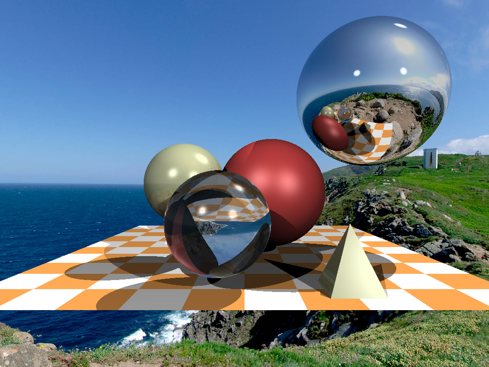

# Разработка трассировщика лучей (Ray Tracer) на Python

Данный репозиторий содержит курсовую работу по компьютерной графике. Проект представляет собой программный рендерер, разработанный с нуля на Python без использования сторонних графических движков (только стандартная библиотека и Pillow для загрузки текстур).

## Структура проекта

*   **`src/`** — исходный код, разбитый на 11 этапов разработки (от простого градиента до сложной сцены с полигонами). Подробное описание каждого шага находится внутри папки.
*   **`results/`** — папка с итоговыми изображениями, сгенерированными на каждом этапе. 
*   **`src/envmap.jpg`** — фоновая карта (текстура), используемая для освещения и фона в финальных шагах.

## Демонстрация

Финальный рендер: сферы с различными материалами (стекло, зеркало, матовый), шахматный пол и полигональная пирамида на фоне карты окружения.



## Технологии

*   Python 3
*   Pillow (используется для чтения фоновой текстуры)
*   Чистая математика (без NumPy — все векторы реализованы через собственный класс `Vec3`).

## Быстрый старт

1. Склонируйте репозиторий или скачайте его архивом.
2. Установите зависимости:
   ```bash
   pip install -r requirements.txt
3. Перейдите в папку src/ и запустите нужный этап (например, финальный):
   ```bash
   python step_11_final.py
